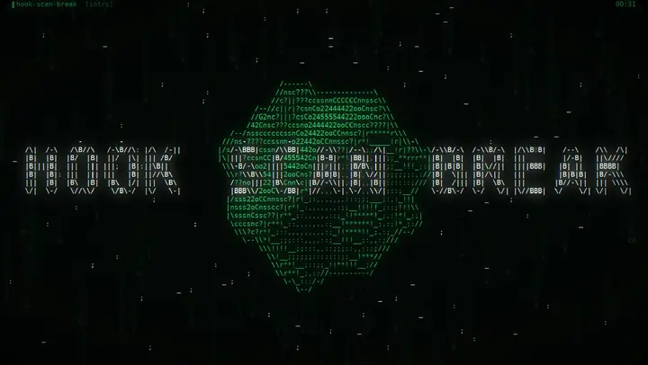

 

## About me

- Data Engineer at **Infrabel**: big data pipelines and AI.
- In my spare time I take games apart: Ghidra, Cheat Engine, injected C++ DLLs, hardware-breakpoint hooks, SMAPI, BepInEx and Unity mods.
- Earlier rounds: reinforcement learning agents for games (PPO, MCTS) and the 42 C curriculum.

## Tech

  

## Featured projects

<table>
  <tr>
    <td width="50%" valign="top">
      <b>Stardew Valley Editor</b> 
      C# · SMAPI 
      Live save and rules editor for Stardew Valley 1.6, driven from a browser UI.  
      </a>
    </td>
    <td width="50%" valign="top">
      <b>Death Must Die Editor</b> 
      C# · Unity 
      In-game item editor and loot tweaker for Death Must Die.  
      </a>
    </td>
  </tr>
  <tr>
    <td width="50%" valign="top">
      <b>Far Cry 6 RE</b> 
      C++ · injected DLL 
      In-process DLL: skeleton ESP, aim assist and HUD overlay, built from reversing the engine.
    </td>
    <td width="50%" valign="top">
      <b>Ghost Recon Wildlands RE</b> 
      C++ · hardware breakpoints 
      Offline ESP, aim assist, weapon and bullet mods, hooked through debug registers without patching code.
    </td>
  </tr>
  <tr>
    <td colspan="2" valign="top">
      <b>Jotunn Trainer</b> 
      C# · BepInEx 6 · Unity IL2CPP 
      In-game trainer for Jotunnslayer: Hordes of Hel: levels past the cap, skill editor, chest and enemy spawns, loot and achievements, without touching the developer console.  
      </a>
    </td>
  </tr>
</table>

<b>AI & reinforcement learning</b>

- [Dino-Run-Recurrent-PPO](https://github.com/Vieuxnorris/Dino-Run-Recurrent-PPO): recurrent PPO agent for Chrome's Dino Run.
- [Projet-MK-RL](https://github.com/Vieuxnorris/Projet-MK-RL): reinforcement learning for Mortal Kombat.
- [ConnectFour_MCTS](https://github.com/Vieuxnorris/ConnectFour_MCTS): Monte Carlo tree search for Connect Four.

## Hook · Scan · Break

  
   
  A procedural ASCII music video: Python renderer, Blender 3D shots, every line of the song with its own animation.

## Stats

  
  

  

<picture>
  <source media="(prefers-color-scheme: dark)" srcset="https://raw.githubusercontent.com/Vieuxnorris/Vieuxnorris/output/snake-dark.svg">
  <source media="(prefers-color-scheme: light)" srcset="https://raw.githubusercontent.com/Vieuxnorris/Vieuxnorris/output/snake.svg">
  
</picture>

